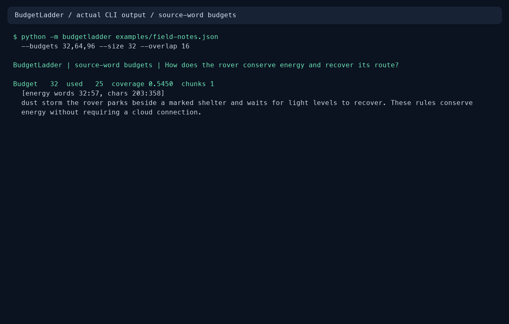
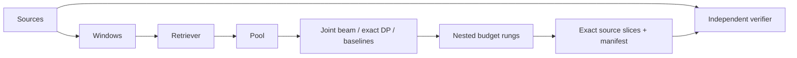

# BudgetLadder

**Auditable evidence plans that keep earlier source evidence when your RAG budget grows.**

[中文](README_zh.md) · [Research & mechanism](docs/innovation.md) · [Experiments](docs/experiments.md) · [API & contracts](docs/architecture.md)

A small, CPU-only research toolkit for one query, one fixed candidate pool and several context budgets. It offers joint nested beam planning, an exact small-pool solver, strong simple baselines, source-overlap accounting and independently verifiable manifests. Python standard library at runtime; no model, API key or GPU.

> **Research finding:** optimizing our weighted source-coverage proxy is not equivalent to preserving answers. On the measured SQuAD sample, simple nested score fill beats the experimental beam planner on gold-span recall. Use the baseline as a practical starting point; use the joint planner and exact oracle to study the tradeoff. This project does not claim SOTA or established first-in-the-world novelty.



The GIF replays **actual CLI output** from the original rover example. [Plain transcript](assets/demo.txt) · [verifiable manifest](assets/demo-manifest.json). It is a programmatic terminal recording, not a GUI screenshot.

## Why a ladder?

Independently packing 64, 96, 128 and 192 source words can remove a previously retained answer when the budget increases. A saved ladder requires `S64 ⊆ S96 ⊆ S128 ⊆ S192`. Overlapping source windows are charged once, and every emitted span retains its document ID and exact character offsets.

The experimental mechanism plans the finite grid jointly rather than committing irrevocably at the first budget. It maximizes the sum of a relevance-weighted source-coverage proxy across rungs, using union costs. The exact subset-DP reference makes approximation errors measurable. Incremental optimization, submodular coverage, overlap merging and beam search are existing techniques; [our contribution and boundaries](docs/innovation.md) are explicit.

**Budgets count Unicode whitespace-delimited source words, not LLM tokens.** Full prompts, headers and generation reserves are outside the budget. Check the actual model tokenizer before invoking an LLM. Nesting applies only within a saved ladder with unchanged sources, scores, candidates and budget grid; it is not a text-prefix or KV-cache guarantee.

## Install

Python 3.10+ on macOS, Linux or Windows. Locally validated on Apple Silicon with Python 3.15; the CI workflow covers Python 3.10/3.12/3.14 on Linux and 3.12 on macOS when GitHub Actions runs.

```bash
git clone https://github.com/paopao-cc/budgetladder.git
cd budgetladder
python3 -m venv .venv
source .venv/bin/activate  # Windows: .venv\Scripts\activate
python -m pip install -e .
```

There are no runtime packages in `requirements.txt`. Installation uses setuptools as build tooling; running directly from the checkout also works with `PYTHONPATH=src`.

## Quick start

```bash
# Practical simple nested reference
budgetladder examples/field-notes.json --strategy nested-rank \
  --budgets 32,64,96 --size 32 --overlap 16 --output output/plan.json

# Independently recompute source hashes, slices, costs and nesting
budgetladder examples/field-notes.json --verify output/plan.json

# Experimental joint beam planner and exact reference
python examples/demo.py
budgetladder examples/field-notes.json --budgets 32,64,96 \
  --size 32 --overlap 16 --candidates 12 --exact
```

Input JSON has `query` and `documents: [{"id": "source", "text": "..."}]`. Input sources stay local; the runtime never sends network requests. See [architecture](docs/architecture.md) for a library example and coordinate semantics. External retrievers can supply scored `Candidate` intervals directly.

## What's included

- Joint finite-grid nested beam planner with deterministic tie-breaking and configurable search width.
- Exact nested subset dynamic program for up to 16 candidates; approximate planning accepts up to 64.
- Score-fill, nested-score, independent guarded density and nested-density baselines using identical overlap costs.
- BM25/sliding-window demo retrieval, merged exact source slices and SHA-256 source manifests.
- Budget, provenance, tampering, random-invariant and exhaustive-optimum tests; a reproducible real-data benchmark and generated interval stress study.



## Measured results

SQuAD 1.1 dev: **300 seeded questions**, BM25 over **2,067 paragraphs / 6,870 windows**, 16 candidates, budgets **64/96/128/192 source words**. Candidate-pool answer-span recall: **91.33%**. These are source-span containment measurements, **not generated-answer accuracy**. Each method has 900 adjacent-budget transitions.

| Method | Mean rung answer-span recall ↑ | Answer-loss transitions ↓ | Mean source-word eviction ↓ | Planner p50 (ms) ↓ |
|---|---:|---:|---:|---:|
| Independent score fill | 76.83% | 3 | 4.65% | 0.138 |
| Nested score fill | 76.58% | 0 | 0.00% | 0.139 |
| Independent density + seed | 64.25% | 24 | 11.24% | 0.260 |
| Nested density greedy | 58.08% | 0 | 0.00% | 0.173 |
| Joint beam, K=1 | 63.58% | 0 | 0.00% | 0.207 |
| Joint beam, K=16 | 62.17% | 0 | 0.00% | 1.468 |

Beam K=16 gains **4.08 percentage points** mean rung recall over nested density greedy, but loses **14.42 points** to nested score fill. The simple nested score baseline also has zero eviction. Thus zero eviction is an invariant of nesting, not unique to beam search. [Raw records, paired article-cluster intervals, per-budget results and failure cases](docs/experiments.md) support these findings.

On 100 generated ten-candidate interval pools, mean relative gap to the exact nested objective is **0.057%** for beam K=16, **7.61%** for K=1, and **1.64%** for nested density greedy. This validates proxy optimization, not QA superiority. CPU timings are single-run local measurements, not hardware-independent guarantees.

## Reproduce

```bash
python -m unittest discover -s tests -v
python experiments/oracle.py
mkdir -p data
curl -fL --compressed https://rajpurkar.github.io/SQuAD-explorer/dataset/dev-v1.1.json \
  -o data/dev-v1.1.json
python experiments/benchmark.py --data data/dev-v1.1.json
```

The benchmark checks gold character offsets, uses answers only for evaluation, saves per-question records and reports article-cluster bootstrap intervals. The checked-in configuration freezes sampling and search parameters. [Dataset checksum and full protocol](docs/experiments.md).

To regenerate the GIF: install Pillow separately, then `python scripts/render_demo.py`. Build release files with `python -m pip install build` and `python -m build`.

## Limitations & roadmap

- The coverage proxy can prefer overlapping or shorter high-density distractors. More search can make answer retention worse; the measured negative result is central to this release.
- BM25 is lexical and the stopword list is English. SQuAD is single-paragraph extractive evidence; no multi-hop, dense/neural retrieval or generated-answer evaluation has run.
- Atomic source windows can underfill budgets or cut sentences. No semantic deduplication across documents, online pool updates, exact model-token budgeting or prompt-injection protection is provided.
- Beam search has no approximation guarantee. Exact mode is exponential. Large pools require a retriever-side shortlist.
- Next: model-token-aware cost adapters, externally supplied utility functions, sentence-aligned intervals, multi-hop evidence and learned-compressor comparisons. These are unimplemented roadmap items.

## Research, data and licensing

The [literature review](docs/literature-review.md) covers **9 verified papers**; [prior art](docs/prior-art.md) compares **5 repositories** and scores three candidate directions. Key references: [uncertain-capacity maximization](https://arxiv.org/abs/1803.02565), [incremental maximization](https://drops.dagstuhl.de/entities/document/10.4230/LIPIcs.ESA.2025.92), [LongLLMLingua](https://aclanthology.org/2024.acl-long.91/), [LLMLingua-2](https://aclanthology.org/2024.findings-acl.57/), [Provence](https://arxiv.org/abs/2501.16214) and [SQuAD](https://aclanthology.org/D16-1264/).

Code, original examples and generated assets: **MIT**. SQuAD is downloaded separately under **CC BY-SA 4.0**, with its own attribution obligations; it is not relicensed by this repository. No passages, answer text or model weights are bundled. [License notes](docs/data-and-licenses.md) · [Contributing](CONTRIBUTING.md).

## Citation

See [CITATION.cff](CITATION.cff). This is a software artifact, not a peer-reviewed paper.

```bibtex
@software{budgetladder2026,
  author = {BudgetLadder contributors},
  title = {BudgetLadder: Nested, overlap-aware evidence plans for changing RAG budgets},
  year = {2026},
  version = {1.0.0},
  url = {https://github.com/paopao-cc/budgetladder}
}
```
