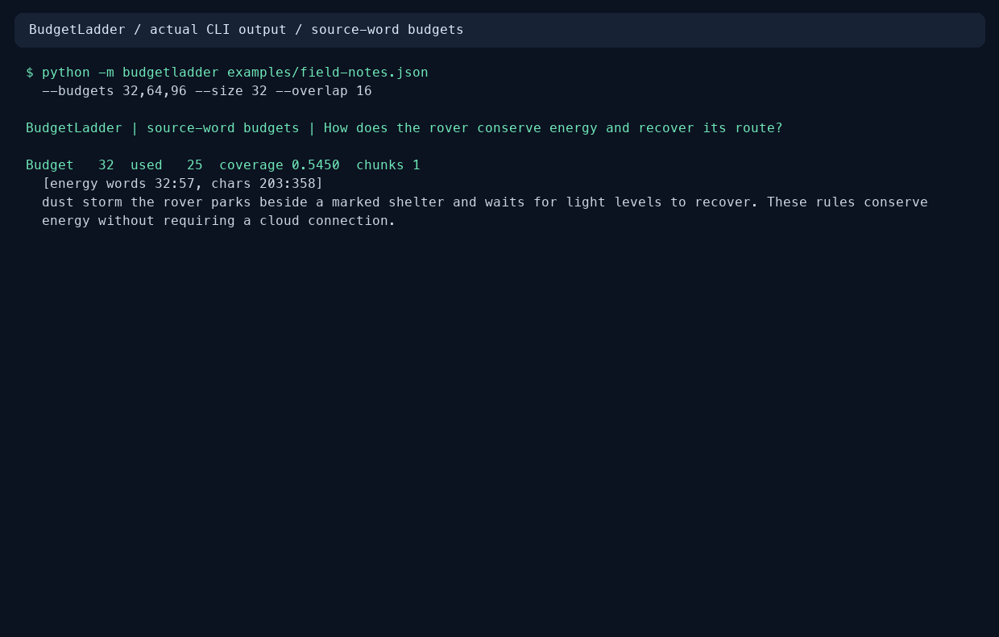

# BudgetLadder

**预算增加时保留已有证据的可审计 RAG 上下文规划工具。**

[English](README.md) · [创新机制](docs/innovation.md) · [实验记录](docs/experiments.md) · [架构](docs/architecture.md)

纯 Python 标准库运行，面向普通 CPU 和 Apple Silicon。为同一查询、固定候选池生成逐级包含的证据集合，并保留源文档、词位置、字符位置和源文件哈希。提供联合 beam 规划、小规模精确解、简单但有竞争力的基线以及独立校验器。

> **真实研究结论：覆盖率代理目标不等于答案保留率。** 在本次 SQuAD 样本中，简单的嵌套分数排序明显优于实验性 beam 规划的答案片段召回率。项目保留这一负面结果，不宣称 SOTA，也不把增量优化、重叠去重或 beam search 称为首创。



录屏来自实际执行的原创 rover 示例；[文本记录](assets/demo.txt)和[可校验清单](assets/demo-manifest.json)可直接检查。这是终端输出的程序化录制，不是 GUI 截图。

## 安装与运行

需要 Python 3.10+，无需 GPU、模型或付费 API。

```bash
git clone https://github.com/paopao-cc/budgetladder.git
cd budgetladder
python3 -m venv .venv
source .venv/bin/activate
python -m pip install -e .
budgetladder examples/field-notes.json --strategy nested-rank \
  --budgets 32,64,96 --size 32 --overlap 16 --output output/plan.json
budgetladder examples/field-notes.json --verify output/plan.json
python examples/demo.py
```

输入 JSON 包含 `query` 和 `documents: [{"id":"文档编号","text":"源文本"}]`。实际运行时数据不发送到外部服务。

**预算单位是按 Unicode 空白分隔的源文本词，不是模型 token。** 系统提示、引用标签、问题和输出预留不计入预算；调用模型前必须使用其真实 tokenizer 检查完整提示。只对已保存方案内的预算档位保证嵌套；更换查询、候选池、分数或预算网格后重新规划，不保证旧结果不变。

## 核心机制与结构

既有研究已经覆盖检索、压缩、次模覆盖、共享成本和增量选择。本项目独立设计并验证的是：在有限预算网格上，将源位置并集成本、跨档位累计效用、嵌套 beam 历史和独立出处校验结合起来，并用精确子集动态规划量化近似误差。

流程：源文档 → 重叠窗口 → BM25/外部检索器 → 候选池 → 联合规划或基线 → 逐级证据集合 → 精确源文切片与清单 → 独立校验。`src/budgetladder/` 包含模型、规划器、检索器、审计和 CLI；`experiments/` 保存真实评估代码和记录。详见[架构与 API](docs/architecture.md)。

## 实验结果

SQuAD 1.1 开发集抽样 300 个问题，检索全部 2,067 个段落，窗口 64 词、重叠 32 词、候选池 16，预算为 64/96/128/192 词。候选池答案片段召回率 91.33%。以下均为答案字符区间被保留的比例，不是生成式问答准确率。

| 方法 | 平均档位召回率 | 答案丢失转移次数（共 900） |
|---|---:|---:|
| 独立分数排序填充 | 76.83% | 3 |
| 嵌套分数排序填充 | 76.58% | 0 |
| 独立密度贪心＋种子保护 | 64.25% | 24 |
| 嵌套密度贪心 | 58.08% | 0 |
| 联合 beam，K=1 | 63.58% | 0 |
| 联合 beam，K=16 | 62.17% | 0 |

联合搜索改善了覆盖率代理目标，却可能保留更多干扰内容。零撤回来自嵌套约束，简单基线也能做到。100 个生成区间案例上，beam K=16 与精确嵌套目标的平均相对差距约为 0.057%，但这不能证明问答优势。[完整结果、置信区间和失败案例](docs/experiments.md)。

## 复现与测试

```bash
python -m unittest discover -s tests -v
python experiments/oracle.py
mkdir -p data
curl -fL --compressed https://rajpurkar.github.io/SQuAD-explorer/dataset/dev-v1.1.json \
  -o data/dev-v1.1.json
python experiments/benchmark.py --data data/dev-v1.1.json
```

已在 macOS arm64 / Python 3.15 上实际执行测试、演示和实验。CI 配置涵盖 Linux 多 Python 版本和 macOS，是否通过以真实 Actions 结果为准。测试包含源文切片、重叠计费、随机嵌套约束、精确解和穷举对照、顺序稳定性及篡改检测。固定配置位于 `configs/squad.json`，逐问题记录保存在 `experiments/results/`。

## 局限与路线图

当前是源证据规划与研究工具，没有运行生成式模型、密集检索、神经压缩器或多跳问答。词预算不能替代模型 token 预算；窗口可截断句子，beam 不保证最优，精确模式限制 16 个候选。BM25 使用英语停用词表。源哈希校验不是数字签名，不证明检索分数或文本内容真实可靠。

后续方向：真实 tokenizer 成本适配、可插拔效用函数、句子对齐窗口、多跳证据、学习式压缩对照。这些均未实现。

## 文献、数据、许可证与引用

[文献综述](docs/literature-review.md)核实了 9 篇论文；[已有项目调研](docs/prior-art.md)比较了 5 个仓库，并对 3 个候选方向评分。创新边界与可证伪假设见[创新说明](docs/innovation.md)。

原创代码、示例与生成素材采用 MIT。SQuAD 数据单独下载，遵循其 CC BY-SA 4.0 及署名要求；仓库不分发源段落、答案文本或模型权重。详见[许可证说明](docs/data-and-licenses.md)。软件引用格式见 [CITATION.cff](CITATION.cff) 与英文 README。本项目不是已发表的同行评审论文。
