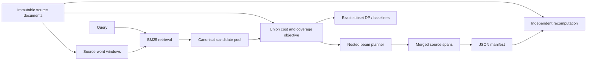

# Architecture and API contracts



- `model.py`: immutable public dataclasses; source-word/character coordinates; validated pool; exact bitset costs; weighted source coverage; deterministic source slices.
- `retrieval.py`: dependency-free sliding windows and BM25 inverted postings. Demo retrieval uses a small fixed English stopword list. Other retrievers may supply arbitrary nonnegative scored `Candidate` objects.
- `planner.py`: approximate joint nested beam search, exact reference and comparable baselines. The finite increasing budget grid and immutable pool are part of the plan identity.
- `audit.py`: serialization and recomputation against the original documents. A hash binds source bytes; it is not a digital signature and cannot attest that retrieval scores were honestly produced. A malicious party can recompute a self-consistent manifest. Validate against trusted inputs.
- `cli.py`: JSON input, readable output, manifest export and verification. No network requests, model downloads or external API calls occur in the library.
- `experiments/`: real source-span evaluation and generated small-pool optimality study, separate from runtime code.

## Coordinates, budget and output

A source word is a maximal `\S+` run under Python Unicode regex semantics. Candidate word and character intervals are half-open. Leading/trailing whitespace is excluded; interior whitespace is copied verbatim. Adjacent/overlapping selected intervals merge. Separate documents are never merged, and duplicate text across sources is charged separately. Joining spans with blank lines preserves the summed whitespace-word count, but model-token counts can change at boundaries.

**This is a source-word evidence budget, not an LLM context-window limit.** System prompts, query, generated output, metadata and any application citation headers are outside the budget. Before calling a model, use its real tokenizer on the full prompt and reserve space separately. Model-token-aware planning is roadmap work; multiplying words by a constant is not a guarantee.

## Stability contract

For a saved plan, rung candidate IDs and source-word positions are nested. Source text can be resegmented when two intervals join, so span IDs/offset-pair lists and text order/prefixes need not remain identical. Replanning with a different query, candidate pool, score, budget grid, beam width or source revision may change earlier rungs. No online update or cache-reuse promise is made.

## Minimal library example

```python
from budgetladder import Document, Candidate, EvidenceProblem, plan_ladder, audit_ladder

docs = [Document("note", "Solar panels charge the rover. Landmarks recover its route.")]
pool = [Candidate("power", "note", 0, 5, .9), Candidate("route", "note", 5, 9, .8)]
problem = EvidenceProblem(docs, pool)
packs = plan_ladder(problem, [5, 9], beam_width=16)
assert audit_ladder(problem, packs)["verified"]
print(packs[-1].text)
```

Scores may be zero but must be finite and nonnegative; IDs must be nonempty and unique. Candidate count is capped at 64 to make accidental unbounded search less likely. Recommended demo pools are 16–24 candidates; exact mode accepts at most 16. Empty pools yield valid empty packs. Atomic windows larger than the smallest budget can leave rungs empty. Character slicing can cut sentences; the library does not rewrite or repair prose.
